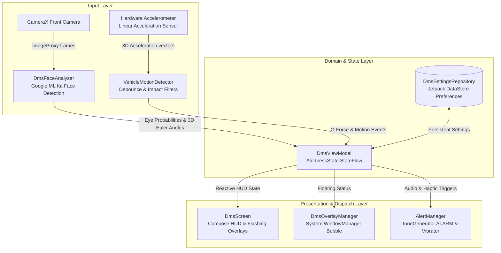

# Driver Monitoring System (DMS) for Android

<p align="center">
  
  
  
  
  
  
  
</p>

An intelligent, on-device **Driver Monitoring System (DMS)** Android application built with modern **Jetpack Compose**, **CameraX**, **Google ML Kit Face Detection**, and **inertial sensor dynamics**. The app actively monitors driver alertness and driving behavior in real-time through the front camera and accelerometer, issuing multi-modal audiovisual warnings for drowsiness, distraction, harsh maneuvers, and severe collisions.

---

## ⚡ Key Highlights

- **🔒 100% On-Device & Private**: All computer vision and sensor inferences run locally using bundled ML Kit models and device sensors. No video frames, telemetry, or sensor readings are recorded, stored, or transmitted.
- **⚡ Zero-Latency Pipeline**: Real-time eye-openness, 3D head-pose, and inertial vehicle dynamics processed frame-by-frame via CameraX `ImageAnalysis` and hardware sensor fusion.
- **🚨 Multi-Modal Alerting**: Immediate audible alarm beeps (`ToneGenerator STREAM_ALARM`), hardware haptics (`VibratorManager`), and visual flashing screen overlays.
- **🛑 Vehicle Dynamics & Crash Detection**: High-rate accelerometer processing detects rapid acceleration, harsh braking, and high-G crash impacts with debounce noise filtering.
- **💬 Universal Floating Bubble Overlay**: Runs as an Android Foreground Service with a draggable, floating status badge over any app (Google Maps, Waze, music players, phone launcher) so monitoring never stops while multitasking.
- **💾 Persistent Settings (Jetpack DataStore)**: All sensitivity thresholds, volume levels, tone styles, and feature toggles persist across app restarts.
- **🔋 OLED Battery Saver Mode**: Shuts off the live camera preview to reduce device thermals and battery consumption while keeping alertness and motion tracking fully active.

---

## 🚀 Features

### 👁️ Real-Time Drowsiness Detection
Tracks **left and right eye-open probabilities** to distinguish natural eye blinks from prolonged eye closure (microsleeps):
- **Warning Stage (Eyes closed > 1.0s)**: Pulsing amber warning HUD border and advisory prompt tone.
- **Critical Stage (Eyes closed > 1.8s)**: High-priority flashing red screen overlay, persistent alarm sirens, and continuous haptic vibrations.

### 🚗 Head Pose & Distraction Tracking
Monitors the driver's head orientation across 3D Euler angles:
- **Yaw (Left / Right)**: Triggers distraction alerts when looking away from the road (> 28°).
- **Pitch (Up / Down)**: Triggers alerts when tilting downward toward a phone or lap (> 22°).
- **Face Absence**: Triggers an alert when the driver's face leaves the camera frame for an extended period (> 1.5s).

### 🛑 Vehicle Dynamics & Crash Detection
Uses hardware linear acceleration sensors (`Sensor.TYPE_LINEAR_ACCELERATION` with fallback to gravity-isolated high-pass filtered accelerometer):
- **Rapid Acceleration (> 3.0 m/s² / ~0.31g)**: Advisory warning for aggressive throttle input.
- **Harsh Braking (> 4.0 m/s² / ~0.41g)**: Rapid warning beeps and visual alert for emergency/hard braking.
- **Severe Crash / Collision (> 3.0g / ~30 m/s²)**: High-G impact spike immediately triggers urgent continuous emergency sirens and full-power SOS vibrations.
- **Pothole / Bump Debouncing**: Requires sustained event duration (> 250ms) to prevent road bumps from causing false alarms.

### 💬 Background Floating Bubble (System-Wide Overlay)
Drivers can multitask or navigate with any app while DMS continuously monitors alertness in the background:
- **Foreground Service**: Binds CameraX, ML Kit, and sensor processing inside `DmsForegroundService` using `FOREGROUND_SERVICE_TYPE_CAMERA` so Android never kills the camera stream.
- **System-Wide Draggable Bubble**: Uses Android's `SYSTEM_ALERT_WINDOW` to float on top of any active app with live eye openness readouts (`L:95% • R:95%`), dynamic motion tags (`BRAKE!`, `ACCEL!`, `CRASH!`), and a color-coded status dot (🟢 Normal, 🟡 Warning, 🔴 Alert).
- **Persistent Alarm Overlays**: Pulses with rapid emergency animations while alarms sound over current device audio.
- **One-Tap Return**: Tapping the bubble instantly returns to the full-screen dashboard.

### 📊 Driver Telemetry HUD
- Real-time gauge metrics for **Left Eye Open %** and **Right Eye Open %**.
- Live **3D Head Pose angle** readout (Yaw & Pitch).
- Real-time **G-Force meter** tracking vehicle dynamics.
- Camera processing framerate counter (**FPS**).

### ⚙️ Customizable Detection Parameters
| Parameter | Default | Configurable Range | Description |
| :--- | :--- | :--- | :--- |
| **Eye Open Threshold** | `0.35` (35%) | `0.15` – `0.60` | Probability threshold below which eyes are marked closed |
| **Drowsy Warning Delay** | `1000 ms` | `600 ms` – `2500 ms` | Closed eye duration before amber warning alert triggers |
| **Drowsy Critical Delay** | `1800 ms` | Fixed | Closed eye duration before emergency critical siren triggers |
| **Distraction Yaw Angle** | `±28°` | `15°` – `45°` | Head rotation angle threshold triggering looking-away distraction alert |
| **Distraction Pitch Angle**| `±22°` | `10°` – `35°` | Downward head tilt angle threshold (e.g., looking at phone/lap) |
| **Distraction Warning Delay**| `1500 ms` | Fixed | Duration looking away before distraction warning triggers |
| **Distraction Critical Delay**| `2500 ms` | Fixed | Duration looking away before critical distraction siren triggers |
| **Rapid Accel Threshold** | `3.0 m/s²` (~0.31g) | `1.5` – `6.0 m/s²` | Linear acceleration limit triggering rapid throttle alert |
| **Harsh Braking Threshold** | `4.0 m/s²` (~0.41g) | `2.0` – `8.0 m/s²` | Deceleration limit triggering hard braking alert |
| **Crash Impact Threshold** | `3.0g` (~30 m/s²) | `1.5` – `6.0g` | Peak impact force triggering emergency crash siren |
| **Alarm Volume** | `100%` | `0%` – `100%` | Hardware audio stream volume for alerts |
| **Alert Tone Style** | `Standard` | `0` – `2` (Standard, Prompt, Key DTMF) | Audio sound effect selection |

---

## 🏗️ Architecture & Data Flow

The project follows the standard Android **MVVM** pattern with Kotlin Coroutines and reactive `StateFlow` streams:



### Tech Stack
- **Language**: Kotlin 2.2.10
- **UI Framework**: Jetpack Compose (BOM `2026.02.01`) + Material 3
- **Camera Pipeline**: CameraX `1.4.1` (`camera-camera2`, `camera-lifecycle`, `camera-view`)
- **Computer Vision**: Google ML Kit Face Detection `16.1.7` (`CLASSIFICATION_MODE_ALL`)
- **Sensors**: Android Sensor Framework (`TYPE_LINEAR_ACCELERATION`, `TYPE_ACCELEROMETER`)
- **Persistence**: AndroidX Jetpack DataStore Preferences `1.1.2`
- **Architecture**: MVVM with Kotlin Coroutines & `StateFlow`
- **Toolchain**: Gradle `9.6.0`, AGP `9.4.1`, JDK `17+`
- **SDK Support**: Min SDK `33` (Android 13) · Target SDK `37` · Compile SDK `37`

---

## 📁 Project Structure

```text
DMS_App
├── app
│   ├── src
│   │   ├── main
│   │   │   ├── AndroidManifest.xml
│   │   │   ├── java/com/example/dms_app
│   │   │   │   ├── MainActivity.kt
│   │   │   │   ├── audio/              # AlertManager (ToneGenerator & Vibrator)
│   │   │   │   ├── data/               # DmsSettingsRepository (DataStore persistence)
│   │   │   │   ├── detection/          # DmsFaceAnalyzer, AlertnessEvaluator, VehicleMotionDetector
│   │   │   │   ├── model/              # AlertnessState, MotionEventType, DmsSettings
│   │   │   │   ├── overlay/            # DmsOverlayManager (Floating bubble WindowManager)
│   │   │   │   ├── service/            # DmsForegroundService (Background camera & sensors)
│   │   │   │   └── ui/                 # DmsScreen, Compose Previews, DmsViewModel
│   │   │   └── res/
│   │   │       ├── layout/             # layout_dms_overlay_bubble.xml (Bubble UI)
│   │   │       └── drawable/           # Bubble shape and status icons
│   │   ├── androidTest/
│   │   └── test/                       # Comprehensive JVM Unit Test Suite (65+ tests)
│   └── build.gradle.kts
├── gradle
│   ├── libs.versions.toml              # Version catalog
│   └── wrapper/
├── build.gradle.kts
├── settings.gradle.kts
├── gradlew
├── LICENSE
└── README.md
```

---

## 🛠️ Getting Started

### Prerequisites
- **Java Development Kit (JDK)**: JDK 17+ (required for AGP 9.4+ / Gradle 9.6+)
- **Android Studio**: Android Studio Ladybug (2024.2+) or newer
- **Android Device or Emulator**: Android 13 (API 33) or higher with front camera support

> [!TIP]
> **Android Emulator Setup**:
> To test face detection inside an Android Virtual Device (AVD), configure your host webcam as the camera source:
> 1. Open **Virtual Device Manager** in Android Studio.
> 2. Click **Edit** (`✏️`) on your AVD.
> 3. Click **Show Advanced Settings**.
> 4. Under **Camera**, change **Front** from `Emulated` to `Webcam0`.
> 5. Launch the emulator.

### Build & Run
1. Clone the repository:
   ```bash
   git clone https://github.com/ZijianOu/DMS_App.git
   cd DMS_App
   ```
2. Open the project in Android Studio and let Gradle sync.
3. Connect your Android device via USB or start your configured AVD.
4. Click **Run** (`Shift + F10`) and grant Camera permissions when prompted.

### Command Line Verification
```bash
# Run comprehensive unit test suite
./gradlew testDebugUnitTest

# Assemble debug APK
./gradlew assembleDebug
```
The compiled APK will be located at `app/build/outputs/apk/debug/app-debug.apk`.

---

## 🎯 Testing & Calibration Tips

1. **Mounting Position**: Mount the phone on a dashboard or windshield phone holder at eye level facing the driver.
2. **Drowsiness Verification**: Close both eyes for > 1.0s to trigger warning audio; hold closed for > 1.8s to trigger critical siren.
3. **Distraction Verification**: Turn your head sideways (as if looking out the passenger window) for > 1.5s to trigger warning; hold for > 2.5s for critical alarm.
4. **Motion Verification**: Rapid forward acceleration or braking triggers audible warnings and updates the G-Force meter. Severe impacts trigger crash sirens.
5. **Eyewear Calibration**: If wearing thick-framed glasses, open Settings (⚙️) and tune the eye closure sensitivity slider to match your resting eye openness.

---

## 🗺️ Roadmap & Upcoming Features

- [x] **Background & System-Wide Overlay Mode**: Run DMS as a Foreground Service with a draggable floating bubble over other apps like Google Maps or Waze.
- [x] **Persistent Settings & Preferences**: Save user thresholds, calibration sensitivity, audio/vibration preferences, and display modes across app restarts using Jetpack DataStore.
- [x] **Vehicle Dynamics & Crash Detection**: Real-time detection of rapid acceleration, harsh braking, and impact collisions.
- [ ] **UI & Layout Optimization**: Streamline dashboard and settings UI, improve landscape/tablet auto-rotation adaptivity, enhance high-contrast sunlight readability, and refine bottom controls ergonomics.
- [ ] **Mouth Opening Ratio (MAR) Yawn Detection**: Detect yawning to capture fatigue before microsleeps occur.
- [ ] **Low-Light Exposure Compensation**: Adaptive sensor exposure for dark cabin driving conditions.
- [ ] **Session Analytics & Safety Score**: Local trip metrics logging alert frequencies and attentiveness duration.
- [ ] **Natural Voice Prompts**: Configurable voice cues (*"Driver drowsy, please focus on the road"*).

---

## ⚠️ Known Limitations

> [!NOTE]
> - **Sunglasses & Polarized Eyewear**: Heavy tinting can obstruct eye probability classification; 3D head-pose and vehicle motion tracking continue functioning normally.
> - **Dark Night Driving**: In total darkness without ambient cabin lighting, RGB cameras have lower face detection confidence.
> - **Mounting Angle Offset**: Mounting more than 45° off-center can skew yaw calculations.

---

## 📄 License

This project is licensed under the Apache License 2.0 - see the [LICENSE](LICENSE) file for details.
